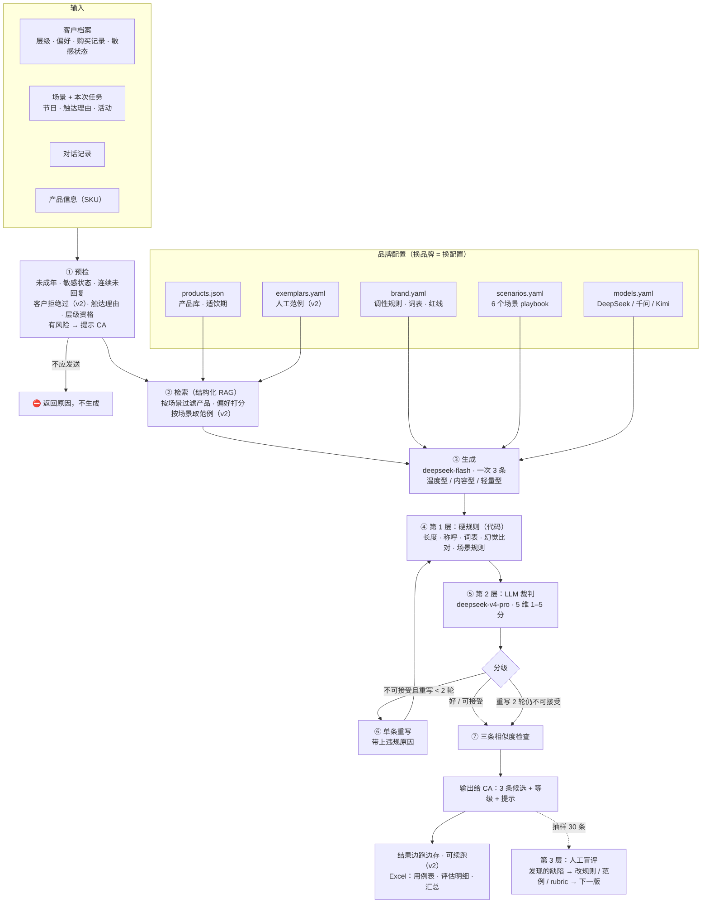

# Maison Ondelune CA 话术工具

为虚构香槟品牌 **Maison Ondelune（月澜香槟）** 的客户顾问（CA）生成企业微信话术：输入客户档案、场景、对话记录和产品信息，输出 3 条中文候选消息（温度型 / 内容型 / 轻量型），并自动预检、规则检查、LLM 裁判打分、不合格的单条重写。

> 品牌、客户、产品、对话全部为虚构。产品的行业参数（保存、侍酒温度等）参考公开资料。

## 架构



固定流程（workflow），不是开放式 agent：预检 → 检索（结构化 RAG + 场景范例）→ 生成 3 条 → 第 1 层硬规则（代码）→ 第 2 层 LLM 裁判 → 单条重写（≤ 2 轮）→ 输出。第 3 层是人工盲评，用来校准规则和裁判、驱动下一版。

## 目录

```
config/      品牌配置：换品牌 = 换这几个文件
  brand.yaml       调性规则、词表、红线、三种策略
  scenarios.yaml   6 个场景 playbook、客户层级
  products.json    产品库（11 个虚构 SKU）
  models.yaml      模型供应商和角色
data/
  test_cases.jsonl 50 个测试用例（35 常规 + 15 边界）
  exemplars.yaml   12 条人工范例（few-shot），情境不与测试用例重合
src/ca_tool/  引擎代码（rules, retrieval, prompts, pipeline, llm, report, cli）
tests/        31 个单元测试（覆盖全部硬规则）
scripts/      make_test_cases / blind_compare / human_label_sheet / drop_failed / build_submission_excel / list_models
docs/         架构图、测试集设计说明
outputs/      运行结果（JSONL + Excel）、盲评表、人工标注表
```

## 安装与运行

```bash
python3 -m venv .venv && source .venv/bin/activate
pip install -e ".[dev]"
pytest -q                                   # 31 passed

cp .env.example .env                        # 填入 DEEPSEEK_API_KEY / HF_TOKEN（不要提交）

# 跑一个用例
python -m ca_tool.cli one data/test_cases.jsonl P01 --generator deepseek --judge deepseek_pro
# 批量跑 50 个用例；中断后加 --resume 续跑
python -m ca_tool.cli batch data/test_cases.jsonl --version v2 --generator deepseek --judge deepseek_pro
# 没有 API key 时用模拟模型跑通流程
python -m ca_tool.cli batch data/test_cases.jsonl --version demo --generator mock --judge mock
```

在新输入上运行：按 `data/test_cases.jsonl` 的格式写一行 JSON（客户、场景、对话、产品、本次任务），再用 `one` 命令运行。

## 版本

| 版本 | 说明 |
| --- | --- |
| v1 | 首次冻结版本（2026-11-08） |
| v2 | 根据 v1 人工标注修改（2026-11-09）：价格异议结构、AI 腔与文艺腔词表、用「您」、话外之音与边界感规则、人工范例 few-shot、裁判 rubric 扣分、客户拒绝预检、批量运行容错与续跑 |

模型：生成 deepseek-flash（DeepSeek-V4.1-Flash-1017），裁判 deepseek-v4-pro（DeepSeek-V4-Pro-0813）；也配置了经 Hugging Face 调用的同一模型、Qwen3.8-27B、Kimi-K3。

## 结果分级

| 等级 | 标准 |
| --- | --- |
| 不可接受 | 触发任一硬规则或红线，或裁判任一维度 ≤ 2 分 |
| 可接受 | 无红线，所有维度 ≥ 3 分；CA 小改后可发 |
| 好 | 无红线，所有维度 ≥ 4 分；CA 可以直接发 |
